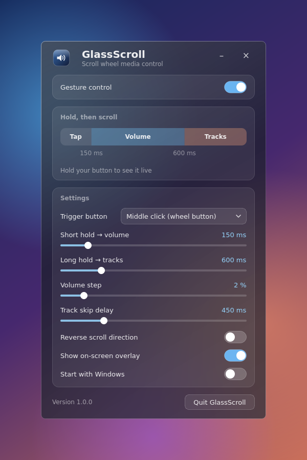
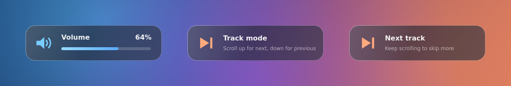

# GlassScroll

### Your scroll wheel. Your volume. Your playlist.

A modern Windows 11 desktop application that turns your mouse scroll wheel into a volume knob and a track skipper, wrapped in a glass-style interface.

<p align="center">

<a href="https://github.com/YOUR_USERNAME/GlassScroll/releases/latest/download/GlassScroll.exe">

</a>

<a href="https://github.com/YOUR_USERNAME/GlassScroll/releases/latest">

</a>

</p>

---

## Overview

GlassScroll lets you control your music without leaving what you are doing.

Hold a mouse button and scroll. A short hold controls the volume. A slightly longer hold skips between tracks. A small glass overlay shows what you are changing.

It works with any player that responds to the Windows media keys, such as Spotify, YouTube Music, VLC, Apple Music and browser players.

---

## Interface

<p align="center">
  
</p>
<p align="center">
  
</p>

---

## How it works

Press and hold your trigger button (middle click by default), then scroll the wheel.

| Gesture | Default timing | Scroll up | Scroll down |
|---|---|---|---|
| Quick tap | under 150 ms | Normal click | Normal click |
| Short hold | 150 ms and longer | Volume up | Volume down |
| Long hold | 600 ms and longer | Next track | Previous track |

Both timings are adjustable in the app. The timeline in the window shows your hold live, so you can see which mode you are in.

---

## Features

### Scroll Gestures

- Short hold and scroll to change the volume
- Long hold and scroll to skip to the next or previous track
- Quick tap still works as a normal click
- Choose the middle button or either side button as the trigger
- Adjustable hold timings, volume step and skip delay
- Option to reverse the scroll direction

### Glass Interface

- Frameless translucent window with Windows 11 acrylic blur
- Click-through volume and track overlay
- Live hold timeline
- Dark glass theme

### System

- Runs quietly in the system tray
- Start with Windows
- Single instance
- Settings are saved automatically

---

## Download

### Windows

<p align="center">

<a href="https://github.com/YOUR_USERNAME/GlassScroll/releases/latest/download/GlassScroll.exe">

</a>

</p>

Download the latest version directly from GitHub Releases.

No Python installation is required.

### Installation

1. Download `GlassScroll.exe`.
2. Place it anywhere on your computer.
3. Run `GlassScroll.exe`.
4. Hold your middle mouse button and scroll.

---

## Windows SmartScreen

The application is currently not digitally signed, so Windows may display:

> Windows protected your PC

This happens because Windows cannot verify the publisher of the executable.

If you downloaded GlassScroll from this repository and trust the source:

**More info → Run anyway**

Each release includes a `GlassScroll.exe.sha256` file so you can verify your download.

---

## Notes

- Windows blocks mouse hooks from reaching windows that run as administrator. Gestures will not work while such a window is focused unless GlassScroll is also run as administrator.
- Track skipping uses the Windows media keys, so it controls whichever player Windows currently treats as active.

---

## Built With

| Technology | Purpose |
|---|---|
| Python | Application logic |
| PySide6 (Qt) | Glass interface and system tray |
| ctypes | Global low-level mouse hook and media keys |
| pycaw | Exact system volume control |
| PyInstaller | Windows executable packaging |
| GitHub Actions | Automated builds and releases |

---

## Architecture

```text
                         GlassScroll
                              |
                 +------------+------------+
                 |                         |
            Gesture Engine              Interface
                 |                         |
        Low-level mouse hook           PySide6 (Qt)
        short / long hold                  |
                 |                +--------+--------+
                 |                |                 |
                 |           Main window         Overlay
                 |           + tray              (HUD)
                 |
         +-------+--------+
         |                |
     Volume (pycaw)   Media keys
                      next / previous
```

---

## Build From Source

Requires Windows 10/11 and Python 3.10 or newer.

```bash
git clone https://github.com/YOUR_USERNAME/GlassScroll.git
cd GlassScroll
python -m pip install -r requirements.txt
python main.py
```

To build the executable:

```bash
build.bat
```

The result is `dist/GlassScroll.exe`.

---

## Releases

Releases are built and published automatically by GitHub Actions.

**Option 1: push a tag**

```bash
git tag v1.0.1
git push origin v1.0.1
```

**Option 2: run it from GitHub**

Open **Actions → Release → Run workflow** and enter a version such as `1.0.1`.

Either way, the workflow runs the tests, builds `GlassScroll.exe`, creates a checksum and publishes a GitHub Release with release notes.

Every push to `main` also runs the **Build** workflow and uploads the executable as a build artifact.

---

## License

MIT
